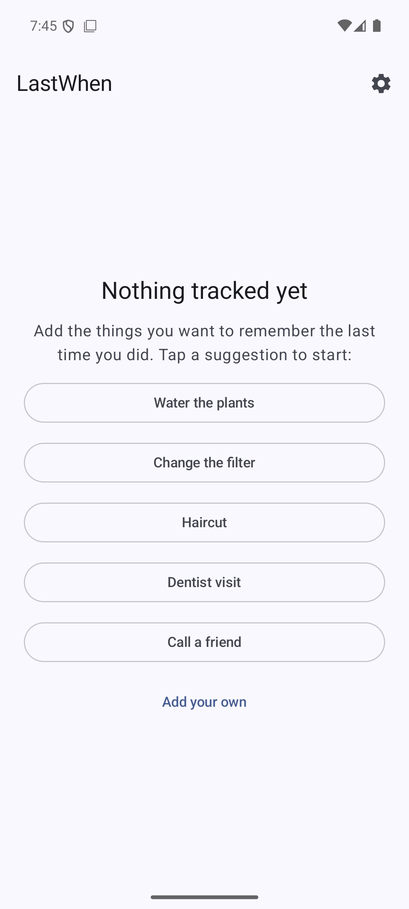
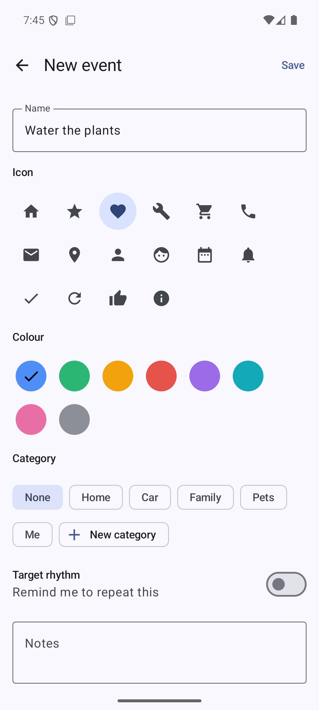
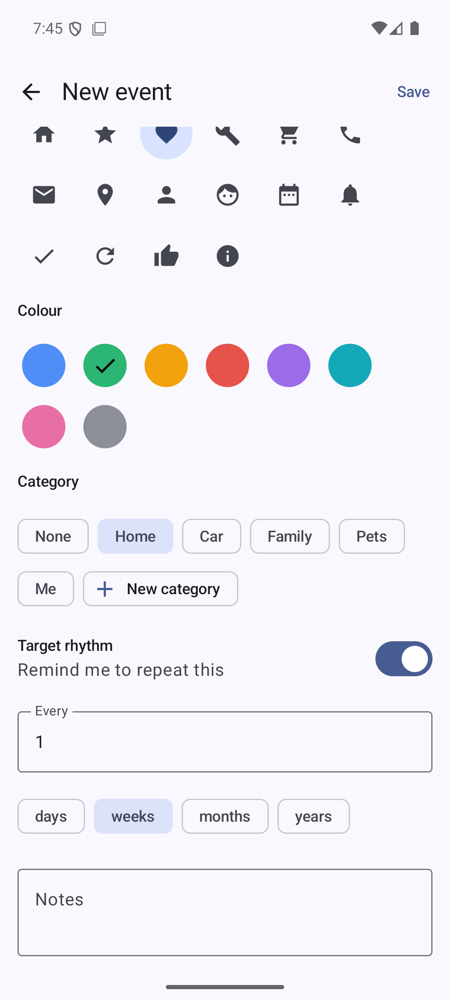
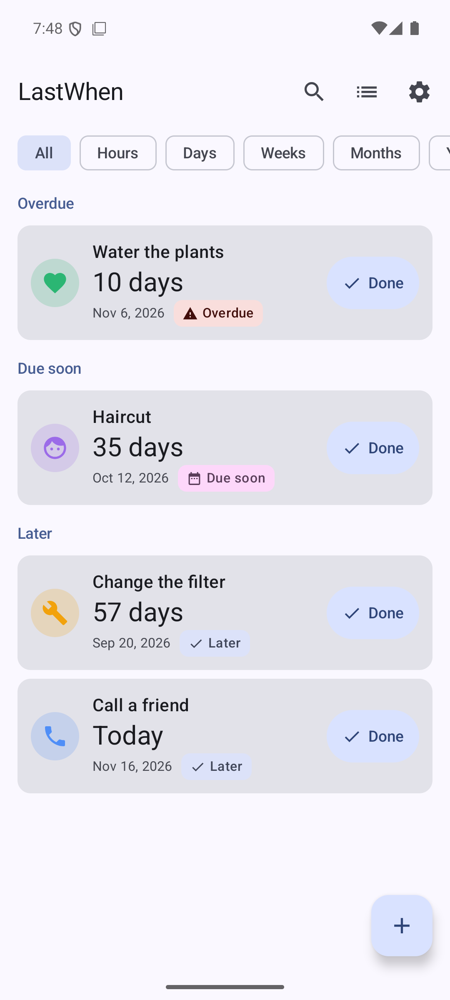
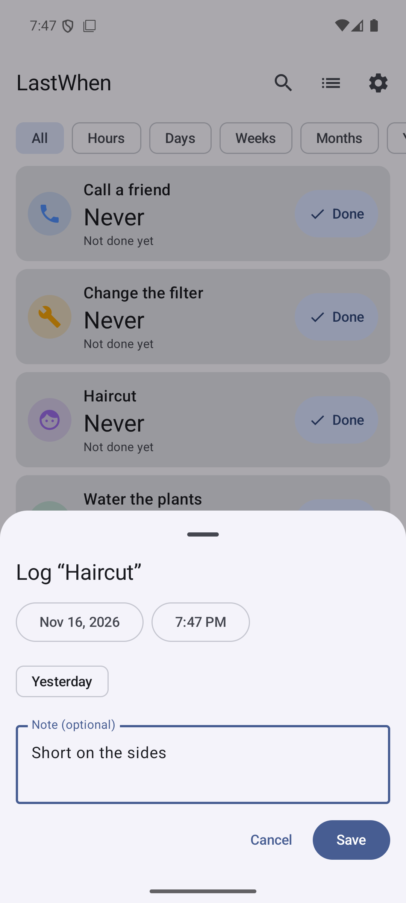
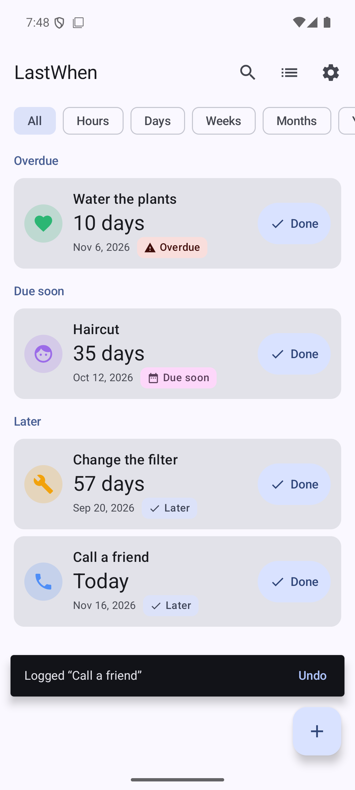
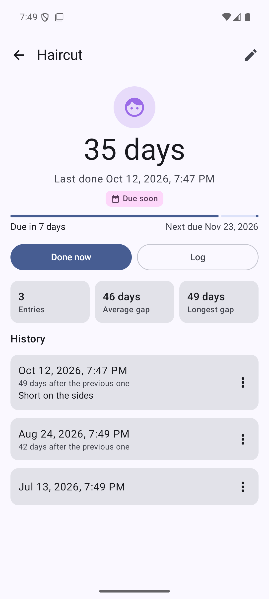
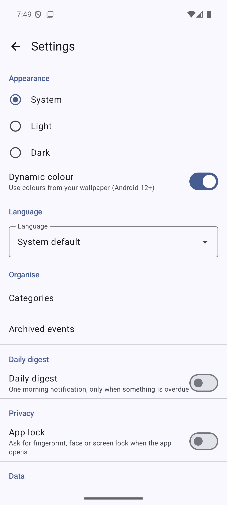

# LastWhen

Native Android app (Kotlin, Jetpack Compose, Material 3). Everything builds inside Docker; nothing but Docker
(and `make`) is needed on the host.

## Features

Track things and see how long ago you last did them: one-tap logging with undo, history with gaps, optional target
rhythm (overdue / due soon), categories, search and filters, archive, JSON backup and CSV export, daily digest,
widgets and app lock. Fully offline: no `INTERNET` permission, no account, no analytics.

App lock and the rest of the app: the lock protects opening the app. With the lock on, the daily digest shows only
the number of overdue events on the device lock screen. Home-screen widgets are outside the lock: they show event
names, and the Single event widget's Done button logs without unlocking. Do not add a widget for events you want hidden.

Status: all four plan phases are implemented. The phase gates that need real use (two weeks of daily use, hand-checked
statuses, backup round trip on a fresh install, digest/widgets/lock on a physical phone) are still to be done.

## Screenshots

<table>
<tr><td align="center"><br><sub>Empty state with suggestions</sub></td><td align="center"><br><sub>New event: icon, colour, category</sub></td><td align="center"><br><sub>Optional target rhythm</sub></td><td align="center"><br><sub>Home: Overdue, Due soon, Later</sub></td></tr>
<tr><td align="center"><br><sub>Log sheet: date, time, note</sub></td><td align="center"><br><sub>One-tap Done with Undo</sub></td><td align="center"><br><sub>History, gaps and statistics</sub></td><td align="center"><br><sub>Settings</sub></td></tr>
</table>

## Commands

```bash
make image      # build the dev image (once, and after Dockerfile changes)
make check      # unit tests and lint
make debug      # debug APK
make install    # install on a device/emulator
make release    # signed APK and AAB (needs signing, see below)
make help       # every target
```

Without `make`: `docker compose run --rm dev ./gradlew :core:test testDebugUnitTest lint`.
CI runs the same targets with `RUN=` (no Docker wrapper).

## App parameters

The name, id and URL are build parameters. Precedence: `-P` Gradle property, then environment variable, then the
tracked `app.properties`, then the default in `app/build.gradle.kts`.

| Parameter | `app.properties` |
|---|---|
| `APP_NAME` | `LastWhen` |
| `APP_ID` | `io.github.desvelao.lastwhen` |
| `APP_URL` | `https://github.com/Desvelao/lastwhen` |
| `APP_VERSION_NAME` / `APP_VERSION_CODE` | not set (the release workflow sets them; defaults `0.1.0` / `1`) |

```bash
APP_NAME="My App" APP_ID=com.example.myapp make debug
```

## Release signing

Create a keystore inside the container (kept out of git) and `keystore.properties`:

```bash
docker compose run --rm dev bash -c '
  PW=$(head -c 24 /dev/urandom | base64 | tr -dc A-Za-z0-9 | head -c 24)
  keytool -genkeypair -keystore release.jks -alias release -keyalg RSA -keysize 4096 -validity 10000 \
    -dname "CN=Release" -storepass "$PW" -keypass "$PW"
  printf "storeFile=release.jks\nstorePassword=%s\nkeyAlias=release\nkeyPassword=%s\n" "$PW" "$PW" > keystore.properties'
```

Or pass `SIGNING_KEYSTORE`, `SIGNING_STORE_PASSWORD`, `SIGNING_KEY_ALIAS`, `SIGNING_KEY_PASSWORD` as environment
variables. A release build without signing details fails on purpose. Back up the keystore: losing it means you
cannot update an installed app.

## Releases

`.github/workflows/release.yml` tests, signs and builds the app on GitHub and publishes a GitHub Release.

1. Add repository secrets: `SIGNING_KEYSTORE_BASE64` (`base64 -w0 release.jks`), `SIGNING_STORE_PASSWORD`,
   `SIGNING_KEY_ALIAS`, `SIGNING_KEY_PASSWORD`.
2. Move the `Unreleased` entries in `CHANGELOG.md` under a new `## [x.y.z] - date` heading.
3. Tag and push: `git tag v1.2.3 && git push origin v1.2.3`. Pre-release tags (`v1.2.3-rc.1`, `-beta.N`, `-alpha.N`)
   create a GitHub pre-release.

Release tags use `versionCode = major*10000 + minor*100 + patch` and `versionName` `1.2.3+<sha>`.
